# salas-post1-u6

## Descripción

Laboratorio de la Unidad 6 de Arquitectura de Computadores (post-contenido): instrucciones x86 y modos de direccionamiento, programados en NASM y verificados con DEBUG sobre DOSBox, en un único repositorio.

- **Estudiante:** Cesar Hernan Salas Peñaranda (cuenta de GitHub `cesarhernansp`)
- **Parte 1:** `lab6_instrucciones.asm`, programa `.COM` con las cuatro categorías de instrucciones (transferencia, aritmética, lógica y control de flujo), una variante factorial del bucle y un Bloque 5 que contrasta `ROL`/`ROR` con `SHL`/`SHR`.
- **Parte 2:** `lab6_modos.asm`, programa `.COM` que demuestra los modos de direccionamiento inmediato, directo, indirecto por registro e indexado, más un marco de pila con `BP` y el acceso a una matriz 3×3 con doble indexación.

## Entorno de trabajo

| Componente | Versión / detalle |
|---|---|
| Sistema anfitrión | Windows 11 Home, 16 GB de RAM |
| Emulador | DOSBox-X 2026.10.01 (ver nota) |
| Ensamblador | NASM 3.02 para DOS (`nasm.exe`, requiere el host DPMI `cwsdpmi.exe`) |
| Depurador | `DEBUG.EXE` de DOSBox-X (`Z:\DOS\DEBUG.EXE`) |
| Editor | VS Code / editor de texto plano; archivos `.asm` en ASCII sin BOM |

**Por qué DOSBox-X.** Los nombres de archivo del laboratorio (`lab6_instrucciones.asm`, `lab6_modos.asm`) exceden el formato 8.3 de DOS, que DOSBox 0.74 no admite. DOSBox-X con `lfn=true` (en `dosbox.conf`) sí los maneja, y además incluye un `DEBUG.EXE`, del que DOSBox 0.74 carece. `nasm.exe` y `cwsdpmi.exe` se copian a la raíz del proyecto (que se monta como `C:\`), pero no se versionan por ser binarios de terceros.

## Compilación y ejecución

```
Z:\> mount C C:\Users\Cesar\salas-post1-u6
Z:\> C:
C:\> cwsdpmi -p
C:\> nasm -v
C:\> nasm -f bin lab6_instrucciones.asm -o lab6_instrucciones.com
C:\> nasm -f bin lab6_modos.asm -o lab6_modos.com
```

Para depurar, se carga el `.com` en DEBUG con el nombre corto que DOS asigna al archivo largo (`debug lab6_i~1.com`, `debug lab6_m~1.com`).

## Estructura del repositorio

```
salas-post1-u6/
├── README.md                    # documentación de ambas partes
├── dosbox.conf                  # configuración de DOSBox-X
├── lab6_instrucciones.asm/.com  # Parte 1 (más el listado .lst)
├── lab6_modos.asm/.com          # Parte 2 (más el listado .lst)
└── capturas/                    # capturas de compilación y de sesiones DEBUG
```

## Parte 1: programa de instrucciones mixtas

`lab6_instrucciones.asm` es un programa `.COM` (`org 100h`) que recorre las cuatro categorías de instrucciones en bloques consecutivos, más una variante factorial del bucle (Bloque 4b) y el Bloque 5 de rotación. Los datos (`valor_a = 45`, `valor_b = 12`, `resultado`, `contador = 5`, `mascara = 0Fh`) están al principio del archivo y un `jmp inicio` los salta. Termina con `INT 20h`. Compila sin errores ni advertencias y ocupa 182 bytes.

En DEBUG las direcciones son el desplazamiento del listado (`lab6_instrucciones.lst`) más `0100h`, porque el programa se carga en `CS:0100`. Los bloques se verificaron con `g <dirección>` (ejecutar hasta un punto) y `t` (una instrucción). Las abreviaturas de flags de DEBUG son `OV/NV` (OF), `NG/PL` (SF), `ZR/NZ` (ZF), `AC/NA` (AF), `PE/PO` (PF) y `CY/NC` (CF).

### Bloques y valores observados

**Bloque 1: transferencia de datos.** `MOV` carga memoria en registros (`AX = 45`, `BX = 12`), `MOV` entre registros (`CX = 45`, `DX = 12`), `LEA` obtiene la dirección de `valor_a` (`SI = 0102h`, no su valor) y `MOV ax, [si]` lee por ese puntero. `XCHG cx, dx` se aplica dos veces (intercambia y restaura) y `PUSH`/`POP` preservan `AX` mientras se sobrescribe temporalmente. Al llegar al Bloque 2, DEBUG muestra `AX=002D BX=000C CX=002D DX=000C SI=0102`.

**Bloque 2: aritmética.**

| Instrucción | Resultado | Flags observados en DEBUG |
|---|---|---|
| `add ax, [valor_b]` (45 + 12) | `AX = 0039h` (57) | `NV PL NZ AC PE NC` |
| `sub ax, [valor_a]` (12 − 45) | `AX = FFDFh` (−33) | `NV NG NZ AC PO CY`: SF = 1 por el resultado negativo y CF = 1 por el préstamo |
| `inc ax` / `dec ax` | `AX` 46, luego 45 | no modifican CF |
| `mul bl` (10 × 7) | `AX = 0046h` (70) | — |
| `div bl` (100 / 7) | `AL = 0Eh` (14), `AH = 02h` (resto) | `AH = 02` se ve en `AX=02B7` del Bloque 3 |

El enunciado indica `OF=0` para el `SUB`, y así se observó (`NV`); además se activa CF, que el comentario original no mencionaba.

**Bloque 3: lógica.**

| Instrucción | Resultado | Flags observados |
|---|---|---|
| `and al, [mascara]` (`B7h` AND `0Fh`) | `AL = 07h` (`AX=0207`) | `NV PL NZ NA PO NC` (AND limpia CF y OF) |
| `or al, 0F0h` | `AL = F7h` | — |
| `xor al, 0FFh` (sobre `AAh`) | `AL = 55h` | — |
| `xor bx, bx` | `BX = 0000h` | `ZR` |
| `test al, 01h` (sobre `B7h`) | `AL` sigue en `B7h` (`AX=02B7`) | `NV PL NZ NA PO NC`: ZF = 0 porque el bit 0 vale 1 (número impar) |
| `shl al, 2` y `shr al, 1` (sobre 8) | 20h y luego 10h | — |

**Bloque 4: control de flujo.** `cmp ax, [valor_b]` calcula 45 − 12 = 33 y deja `NV PL NZ NA PE NC`; como ZF = 0 y SF = OF, `jg .mayor` salta (DEBUG muestra `JG 0171`) y `CX = 1`. Después el bucle de `LOOP` suma 1 + 2 + 3 + 4 + 5: al llegar a `INT 20h`, DEBUG muestra `AX=000F` (15), `BX=0006` y `CX=0000`.

**Bloque 4b: variante factorial (5! = 120).** Reutiliza el esqueleto del bucle de suma con tres cambios: `MUL bx` reemplaza a `ADD ax, bx`, el acumulador parte de `AX = 1` (elemento neutro del producto) y `BX` recorre 1, 2, 3, 4, 5. `MUL bx` calcula `DX:AX = AX × BX`; mientras el producto cabe en 16 bits, `DX` vale 0. En DEBUG se vieron las primeras iteraciones (`AX = 1`, luego `AX = 2`) y el resultado final `AX=0078` (120), con `BX=0006`, `CX=0000` y `DX=0000`; el volcado de `resultado` en `0106h` muestra `78 00`. Se agregó como bloque aparte, después de la suma, para conservar el `AX = 15` verificado, y se publicó en un commit separado.

**Bloque 5: rotación frente a desplazamiento.** Se parte de `AL = 81h` (`1000 0001b`) y cada instrucción opera sobre una copia:

| Instrucción | Registro final | CF | Qué ocurre con el bit que sale |
|---|---|---|---|
| `shl bl, 1` | `BL = 02h` | 1 | el bit 7 original se pierde; solo queda en CF |
| `rol cl, 1` | `CL = 03h` | 1 | el bit 7 reaparece como bit 0 |
| `shr dl, 1` | `DL = 40h` | 1 | el bit 0 original se pierde; solo queda en CF |
| `ror bh, 1` | `BH = C0h` | 1 | el bit 0 pasa a ser el bit 7 |
| `rol al, 4` (con `AL = A5h`) | `AL = 5Ah` | 0 | los nibbles se intercambian |

Además de CF, `SHL`, `ROL` y `SHR` dejaron `OV` (OF = 1, definido para desplazamientos de un bit) y `ROR` dejó `NV`. Tras el último `ROL`, `CF = 0` porque el bit 0 de `5Ah` es 0.

### Capturas de la Parte 1

| Checkpoint | Captura |
|---|---|
| 1. Compilación exitosa (`nasm -v`, `nasm -f bin ...`, `dir`) | `capturas/p1_cp1_compilacion.png` |
| 2. DEBUG: `ADD` (`AX = 57`) y `SUB` con flags | `capturas/p1_cp2a_debug_add_sub.png` |
| 2. DEBUG: `AND`, `TEST`, `CMP` y `AX = 15` tras el bucle | `capturas/p1_cp2b_debug_and_test_cmp_bucle.png` |
| 3. Variante factorial (`AX = 0078`) | `capturas/p1_cp3_factorial.png` |
| 4. Rotación (`BL`, `CL`, `DL`, `BH` y `AL = 5Ah`) | `capturas/p1_cp4_rotacion.png` |
| 5. Decisiones técnicas de la Parte 1 (recuento de palabras) | `capturas/p1_cp5_decisiones.png` |


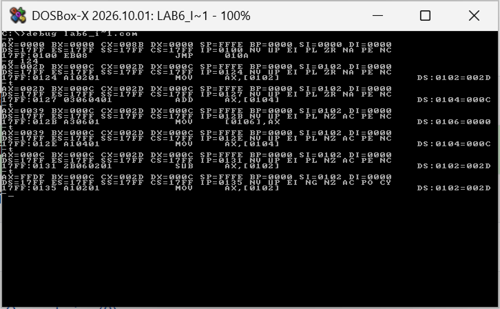
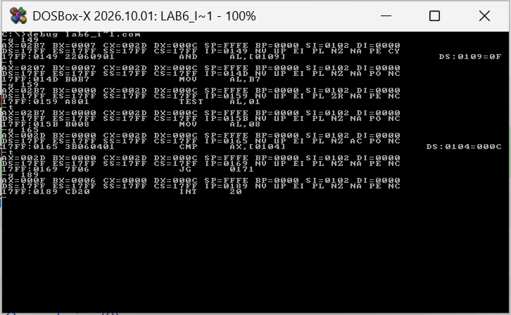

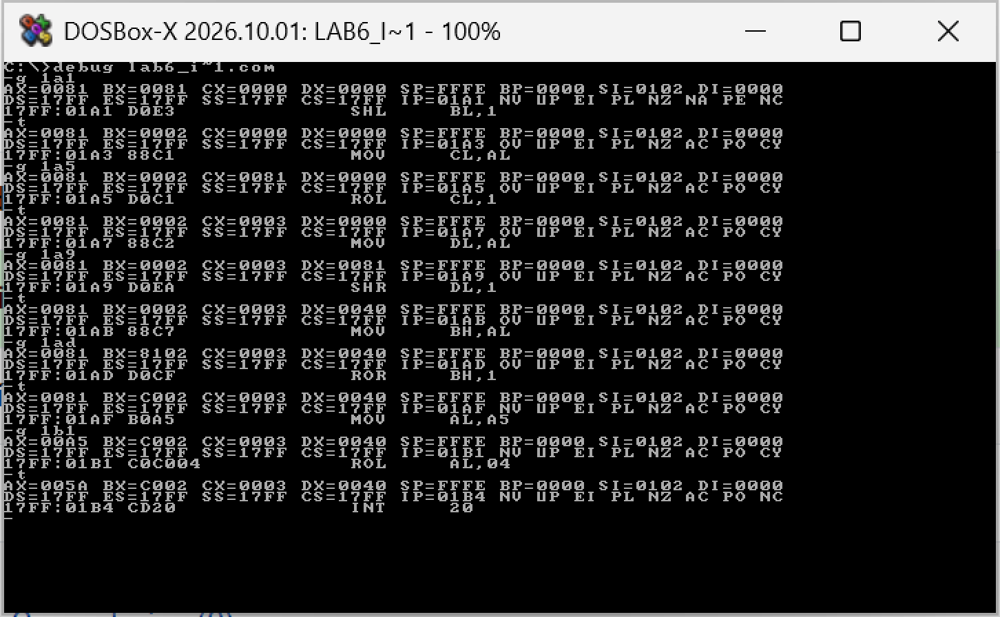


## Decisiones técnicas (Parte 1)

### Decisión 1: ¿SHL/SHR o ROL/ROR para esta manipulación de bits?

SHL y SHR son la opción correcta para la aritmética: multiplicar o dividir por potencias de 2, como `shl al, 2` (8 × 4 = 32) y `shr al, 1` (32 / 2 = 16) del Bloque 3. El bit que sale del registro no aporta al resultado numérico (es el desbordamiento o el resto) y puede descartarse, quedando a lo sumo en CF. ROL y ROR son preferibles cuando ningún bit debe perderse: el intercambio de nibbles del Bloque 5 (`rol al, 4` convierte `A5h` en `5Ah`), un checksum circular o un cifrado por rotación. SHL no puede intercambiar los nibbles de un byte: tras `shl al, 4` el registro vale `50h` y el nibble alto `A` ya no existe, de modo que ningún `OR` con constantes lo recupera; solo se lograría conservando antes una copia del byte y combinando `SHL`, `SHR` y `OR`, en cuatro instrucciones en lugar de una. Con `AL = 81h`, `shl al, 1` deja `AL = 02h` y el bit 7 (que valía 1) solo sobrevive en CF; `rol al, 1` deja `AL = 03h`, y ese mismo bit reaparece como bit 0. Esa diferencia decide cuál usar: descartar o preservar.

### Decisión 2: ¿LOOP o DEC/JNZ para el bucle del Bloque 4?

LOOP es más compacta y legible: una sola instrucción de dos bytes (`E2 FB` en el listado) decrementa `CX` y salta si no es cero, mientras que `dec cx` más `jnz` ocupan tres bytes y dos líneas. Sin embargo, el número de instrucciones escritas no es un indicador confiable del tiempo de ejecución: cada instrucción tiene su propio costo de decodificación y ejecución, y en muchos procesadores posteriores al 8086 LOOP se implementa con microcódigo y tarda más ciclos que el par `DEC`/`JNZ`, que además pueden fusionarse en una sola micro-operación; en el 8086 original ocurría lo contrario. Para el bucle de 5 iteraciones del Bloque 4 la diferencia es de nanosegundos y no tiene ningún impacto perceptible. Si el mismo bucle se ejecutara millones de veces dentro de un programa mayor, la diferencia por iteración se multiplicaría y sí podría importar, y por eso los compiladores modernos suelen emitir `DEC`/`JNZ` en lugar de `LOOP`. En este laboratorio se conservó LOOP porque la legibilidad pesa más que un costo invisible.

## Parte 2: modos de direccionamiento

`lab6_modos.asm` es un programa `.COM` (`org 100h`) que define un array de 5 enteros de 16 bits, un registro de tres campos (`nota1`, `nota2`, `promedio`), una variable `var_x`, una tabla de bytes y una matriz de 3×3, y los accede con distintos modos de direccionamiento. Cada bloque del código lleva en su cabecera el modo que demuestra. Compila sin errores y ocupa 208 bytes.

Los datos están antes del código y no se movieron durante el desarrollo: `array` en `0102h`, `nota1` en `010Ch`, `nota2` en `010Eh`, `promedio` en `0110h`, `var_x` en `0112h`, `tabla_hex` en `0114h` y `matriz` en `0124h`. Las capturas de los checkpoints 1 a 4 se tomaron con la versión del programa vigente en el commit correspondiente; al añadir la matriz (18 bytes de datos) las direcciones de **código** se desplazaron 12h bytes, de modo que las direcciones de instrucciones del listado final difieren de las de esas capturas, pero las direcciones de datos y los valores de registros son los mismos.

### Tabla resumen de los modos de direccionamiento

| Modo | Fórmula de la dirección efectiva (EA) | Instrucción NASM | Valor observado en DEBUG |
|---|---|---|---|
| Inmediato | no hay EA: el operando va en el opcode | `mov ax, 100` | `U` muestra `MOV AX,0064` (`B8 64 00`); `AX = 0064h` |
| Directo | EA = desplazamiento fijo = `0112h` | `mov ax, [var_x]` | `DS:0112=FFFF`; `AX = FFFFh`. Con `mov word [var_x], 0` el volcado de `0112h` pasa a `00 00` |
| Indirecto por registro (SI) | EA = `SI` | `mov ax, [si]` con `SI = 010Ch` | `DS:010C=0055`; `AX = 0055h` (85) |
| Indexado (base + índice) | EA = `BX + SI` = `0102h + 4` | `mov ax, [bx + si]` | `DS:0106=001E`; `AX = 001Eh` (`array[2] = 30`) |
| Indexado (base + índice), bucle | EA = `BX + SI`, con `SI` de 0 a 8 | `add ax, [bx + si]` | tras 5 iteraciones `AX = 0096h` (150) |
| Base + desplazamiento (campos del registro) | EA = `BX + 2` / `BX + 4` con `BX = 010Ch` | `mov cx, [bx + 2]`, `mov dx, [bx + 4]` | `DS:010E=0049` (73) y `DS:0110=004F` (79) |
| Indirecto por BP (marco de pila) | EA = `BP + desp.` en el segmento **SS** | `mov ax, [bp - 2]` con `BP = FFFCh` | `SS:FFFA=0063`; `AX = 0063h` y tras el `ADD` `AX = 015Dh` (349) |
| Matriz 2D (doble indexación) | EA = `BX + SI`, con `SI = fila × 6 + columna × 2 = 0Ah` y `BX = 0124h` | `mov dx, [bx + si]` | `DS:012E=0006`; `DX = 0006h` (`matriz[1][2]`) |

### Checkpoint 1: estructura en memoria

Con `d 100 12f` se ve el volcado del programa (`17FF:0100`):

```
EB 22                       jmp inicio (en esa versión salta hasta 0124h; en la final es EB 34 hasta 0136h)
0A 00 14 00 1E 00 28 00 32 00   array: 10, 20, 30, 40, 50 en little-endian
55 00                       nota1 = 85  (55h)
49 00                       nota2 = 73  (49h)
00 00                       promedio = 0
FF FF                       var_x = 0FFFFh
30 31 32 33 ... 45 46       tabla_hex ("0123456789ABCDEF")
```

`u 124 12f` desensambla el modo inmediato (en el programa final está en `0136h` y `p2_cp2b_directo.png` lo muestra con `u 136 142`): `MOV AX,0064`, `MOV BX,00A5`, `ADD CX,+37` y `AND DX,00FF`. El valor de cada constante aparece dentro del opcode.

### Checkpoint 2: trazado del modo indirecto

Traza con `g 142` y ocho `t`. `SI` pasa de `0000` a `010C` con `mov si, nota1`, y `AX` vale `0055h` después de `mov ax, [si]`:

| Instrucción | Registro modificado | Valor resultante |
|---|---|---|
| `mov si, nota1` | `SI` | `0000` → `010C` (dirección de `nota1`) |
| `mov ax, [si]` | `AX` | `FFFF` → `0055` (85; EA = `DS:010C`) |
| `mov si, nota2` | `SI` | `010C` → `010E` |
| `mov bx, [si]` | `BX` | `000A` → `0049` (73; EA = `DS:010E`) |
| `add ax, bx` | `AX` | `0055` → `009E` (158) |
| `shr ax, 1` | `AX` | `009E` → `004F` (79) |
| `mov si, promedio` | `SI` | `010E` → `0110` |
| `mov [si], ax` | memoria `DS:0110` | `0000` → `004F`; `d 110 111` muestra `4F 00` |

El modo directo se verificó aparte: `mov ax, [var_x]` leyó `DS:0112=FFFF`, `mov bx, [array]` leyó `DS:0102=000A` y `mov cx, [nota1]` leyó `DS:010C=0055`.

### Checkpoint 3: modo indexado y extensión

El bucle de suma del array termina con `AX=0096` (150), `CX=0000` y `SI=000A`. Antes, `mov ax, [bx + si]` con `BX = 0102h` y `SI = 4` accedió a `DS:0106=001E`, es decir `array[2] = 30`. La extensión, publicada en un commit separado (`feat: recorrido inverso del array`), recorre el array desde `array[4]` hacia `array[0]` con `SI` partiendo de 8 y decrementándose de 2 en 2: el primer acceso fue `DS:010A=0032` (50), el siguiente `DS:0108=0028` (40), y al terminar `AX=0096` (150) con `SI=FFFE`.

### Checkpoint 4: marco de pila con BP

| Instrucción | SP | BP | Observación |
|---|---|---|---|
| (antes del bloque) | `FFFE` | `0000` | |
| `push bp` | `FFFC` | `0000` | se guarda el BP del programa principal |
| `mov bp, sp` | `FFFC` | `FFFC` | `BP` y `SP` valen lo mismo |
| `sub sp, 4` | **`FFF8`** | `FFFC` | se reservan 4 bytes para dos variables locales |
| `mov word [bp - 2], 99` | `FFF8` | `FFFC` | escribe `63 00` en `SS:FFFA` |
| `mov word [bp - 4], 250` | `FFF8` | `FFFC` | escribe `FA 00` en `SS:FFF8` |
| `mov ax, [bp - 2]` | `FFF8` | `FFFC` | `AX = 0063` (99) |
| `add ax, [bp - 4]` | `FFF8` | `FFFC` | `AX = 015D` (349) |
| `mov sp, bp` | `FFFC` | `FFFC` | libera las variables locales |
| `pop bp` | `FFFE` | **`0000`** | `BP` vuelve a su valor original |

El volcado `d fff8 ffff` muestra `FA 00 63 00 ...`, es decir `SS:BP-4` = `FA 00` y `SS:BP-2` = `63 00`. DEBUG anota en cada acceso con BP el segmento `SS:` (`SS:FFFA`, `SS:FFF8`), a diferencia de los accesos con `BX`/`SI`, que anota como `DS:`.

### Checkpoint 5: acceso a la matriz

`d 124 135` muestra la matriz completa: `01 00 02 00 03 00 | 04 00 05 00 06 00 | 07 00 08 00 09 00`. El cálculo de `matriz[1][2]` pasa por `AX = 3` (tras `mul bx`), `AX = 6` (tras `shl ax, 1`), `SI = 6`, `CX = 4` (tras `shl cx, 1`), `SI = 000A` (tras `add si, cx`) y `BX = 0124`; la lectura accede a `DS:012E=0006` y deja `DX = 0006`.

### Capturas de la Parte 2

| Checkpoint | Captura |
|---|---|
| 1. Compilación | `capturas/p2_cp1a_compilacion.png` |
| 1. Dump de la estructura en memoria y modo inmediato (`d`, `u`) | `capturas/p2_cp1b_dump_array.png` |
| 2. Modo directo | `capturas/p2_cp2b_directo.png` |
| 2. Trazado del modo indirecto | `capturas/p2_cp2_indirecto.png` |
| 3. Modo indexado y `AX = 150` (bucle original) | `capturas/p2_cp3a_indexado_150.png` |
| 3. Recorrido inverso y `AX = 150` | `capturas/p2_cp3b_inverso_150.png` |
| 4. Marco de pila con BP (SP, BP y dump) | `capturas/p2_cp4_marco_bp.png` |
| 5. Compilación con la matriz | `capturas/p2_cp5a_compilacion_matriz.png` |
| 5. Dump de la matriz y `DX = 0006` | `capturas/p2_cp5b_matriz.png` |
| 6. Decisiones técnicas de la Parte 2 (recuento de palabras) | `capturas/p2_cp6_decisiones.png` |


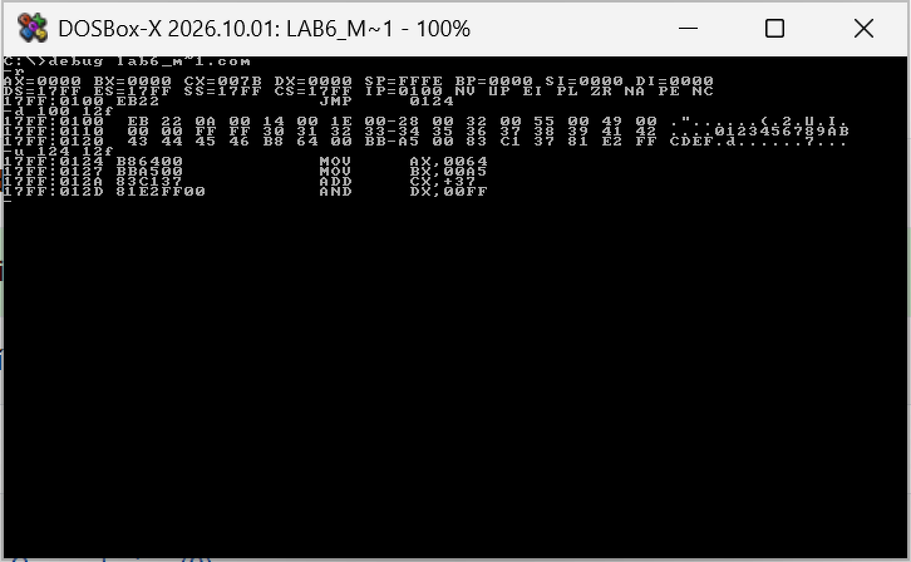
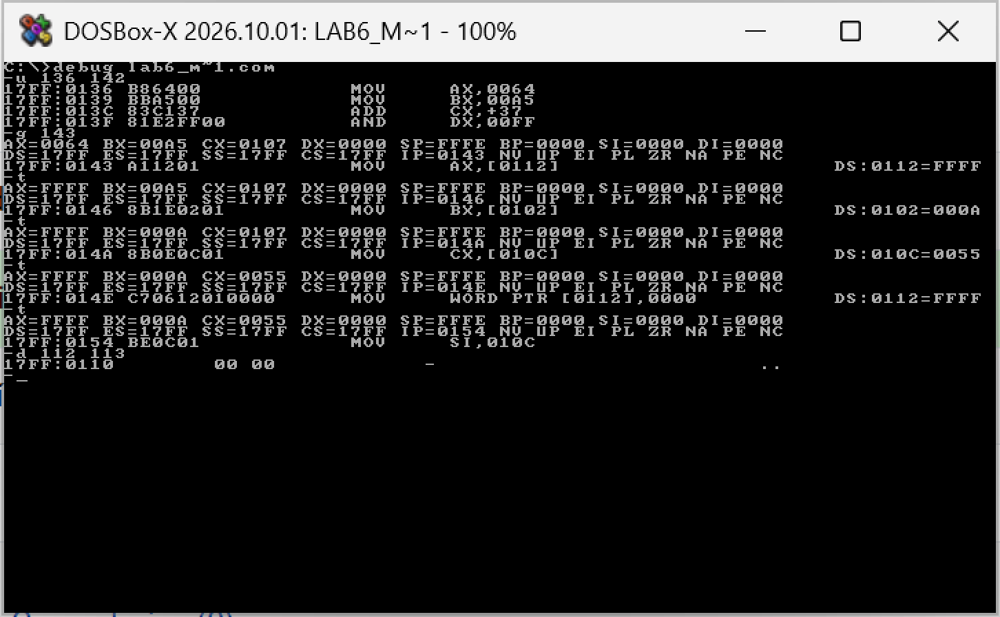
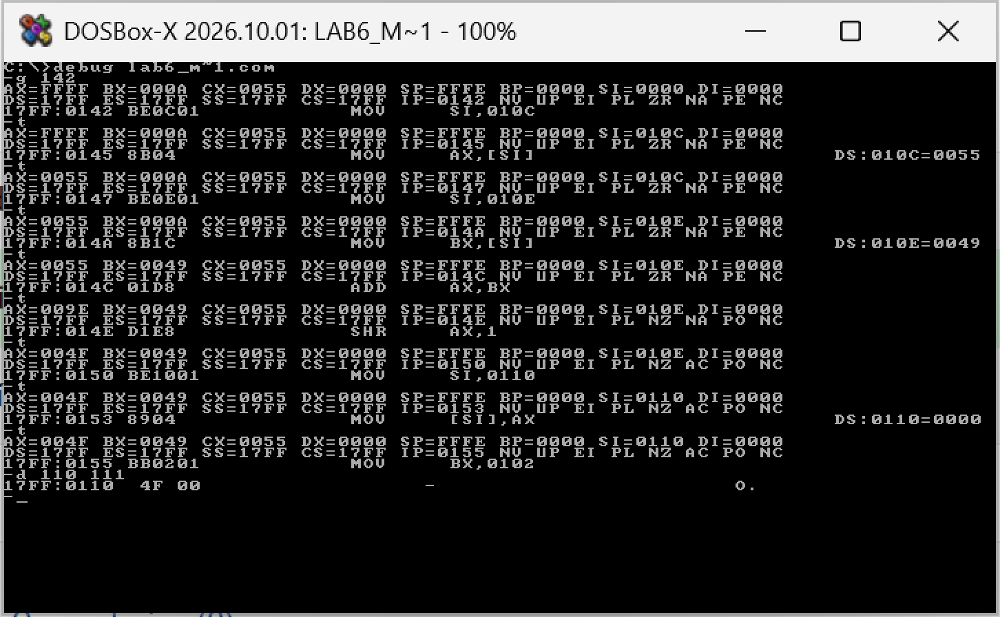
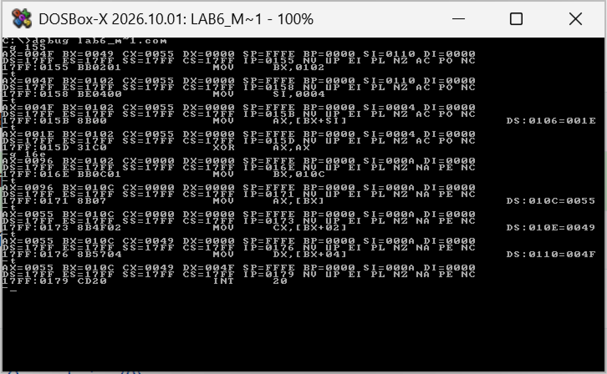
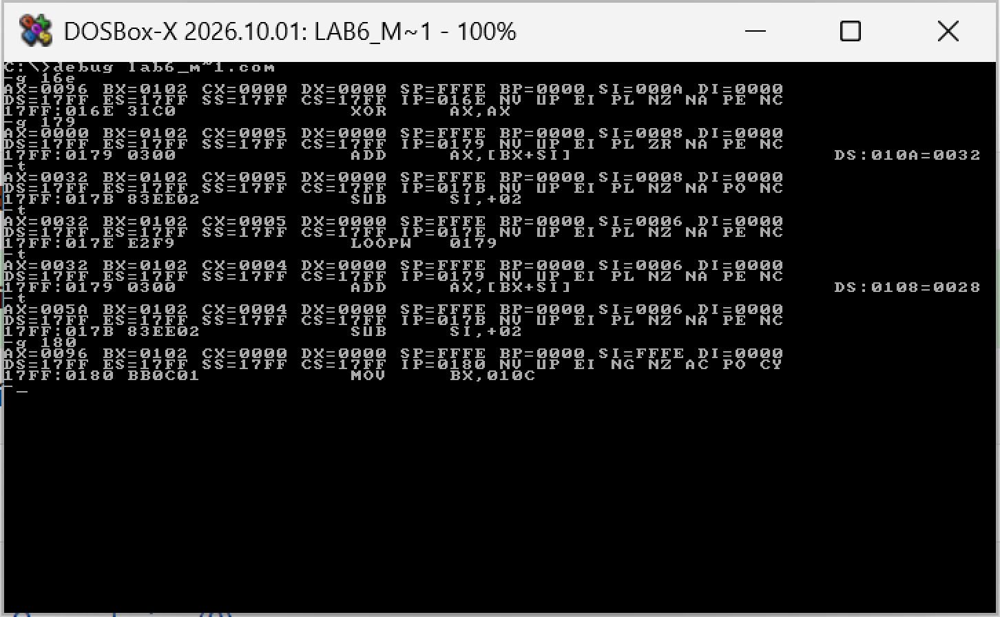
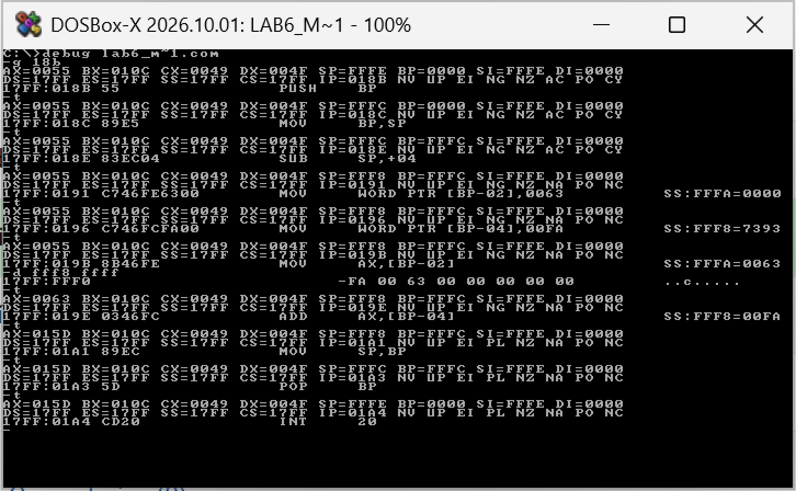
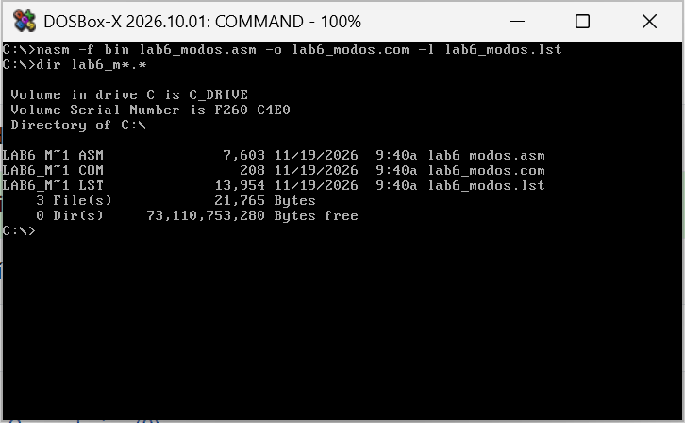
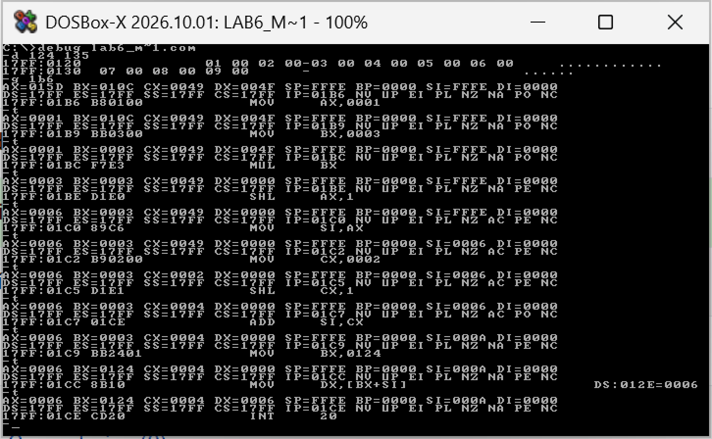
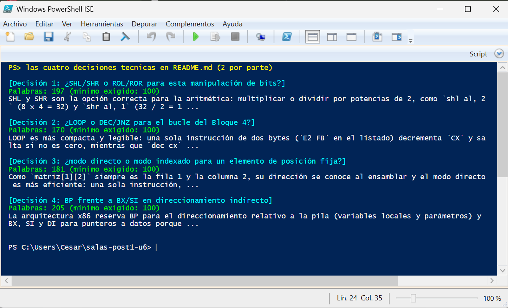

## Decisiones técnicas (Parte 2)

### Decisión 3: ¿modo directo o modo indexado para un elemento de posición fija?

Como `matriz[1][2]` siempre es la fila 1 y la columna 2, su dirección se conoce al ensamblar y el modo directo es más eficiente: una sola instrucción, como `mov dx, [matriz + 10]`, lleva la dirección embebida en el opcode y NASM la resuelve en tiempo de ensamblado. El modo indexado del Paso 7 paga en tiempo de ejecución el cálculo de la dirección efectiva con una `MUL`, dos `SHL`, un `ADD` y varios `MOV` adicionales; la `MUL` es una de las instrucciones más caras del repertorio (decenas de ciclos en el 8086), y todo ese trabajo produce siempre el mismo número, 10. El indexado se vuelve indispensable cuando la fila o la columna no se conocen al compilar sino que dependen de una variable calculada en ejecución, por ejemplo el índice de un bucle que recorre la matriz. Para sumar las 9 posiciones, usar direccionamiento directo con 9 etiquetas sería impráctico: exigiría nueve instrucciones casi idénticas y no escalaría (una matriz de 100×100 requeriría diez mil), mientras que un único bucle indexado, con unas pocas instrucciones, funciona para cualquier tamaño.

### Decisión 4: BP frente a BX/SI en direccionamiento indirecto

La arquitectura x86 reserva BP para el direccionamiento relativo a la pila (variables locales y parámetros) y BX, SI y DI para punteros a datos porque cada grupo tiene un segmento por defecto distinto: BP usa SS y los demás usan DS. Así el código de un marco de pila alcanza sus variables sin cargar ningún registro de segmento, y el hardware sabe a qué segmento ir. La traza lo confirmó: DEBUG anotó `SS:FFFA` para `[bp - 2]` y `DS:010C` para los accesos con `BX` o `SI`. En este `.COM`, con un único segmento, DS y SS valen lo mismo (`17FF`) y BP o BX producen el mismo resultado. En un `.EXE` con segmentos de datos y de pila separados (DS ≠ SS) la diferencia sería crítica: si el código supusiera que `[bp + desplazamiento]` apunta al mismo segmento que `[bx + desplazamiento]`, leería el dato de la pila en lugar del de datos, o al revés, y obtendría basura sin ningún aviso. Para forzar el segmento DS en una instrucción con BP se usa un prefijo de sobrescritura de segmento, como `mov ax, [ds:bp + 2]`, útil cuando se agotan BX, SI y DI y se necesita BP como registro de índice sobre datos.
