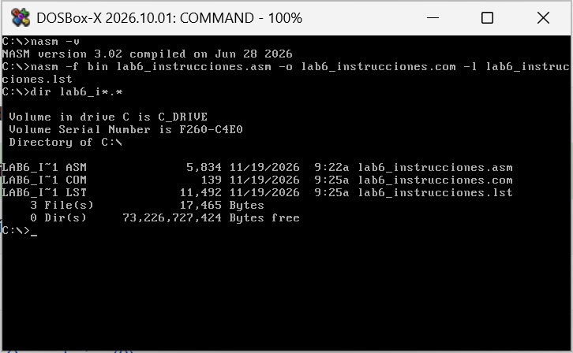
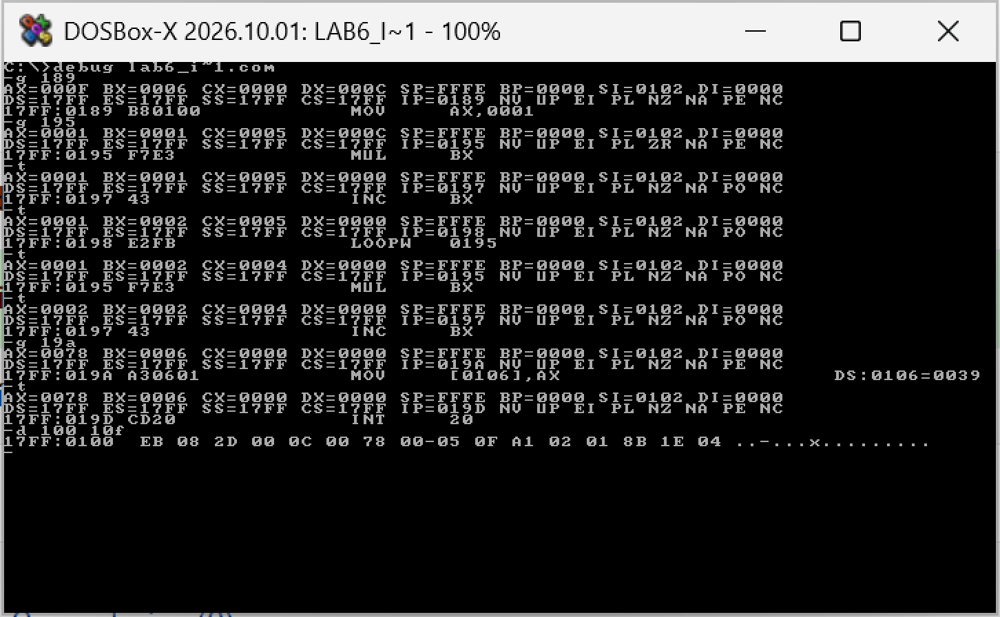
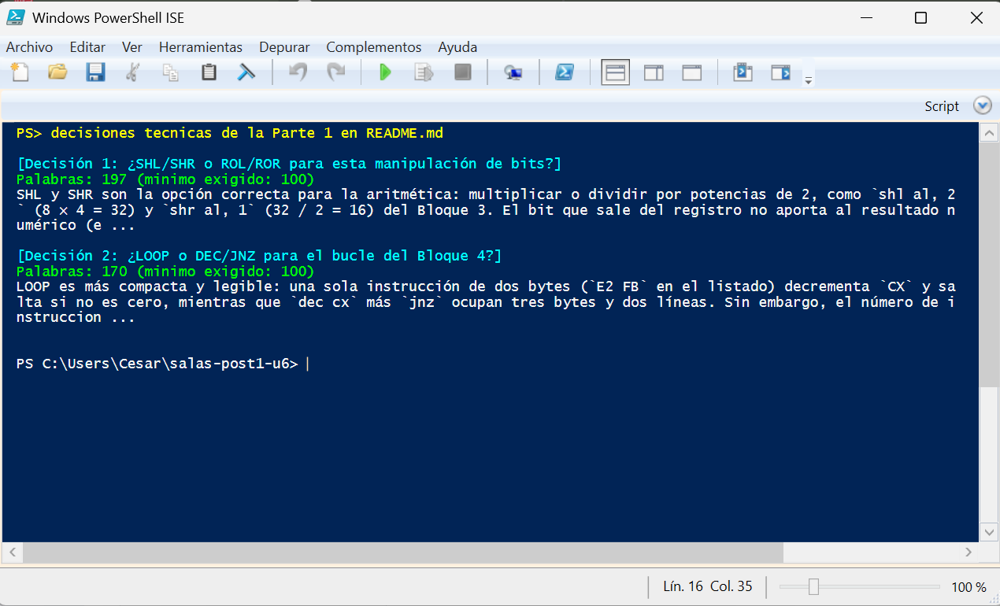

# salas-post1-u6

## Descripción

Laboratorio de la Unidad 6 de Arquitectura de Computadores (post-contenido): instrucciones x86 y modos de direccionamiento, programados en NASM y verificados con DEBUG sobre DOSBox, en un único repositorio.

- **Estudiante:** Cesar Hernan Salas Peñaranda (cuenta de GitHub `cesarhernansp`)
- **Parte 1:** `lab6_instrucciones.asm`, programa `.COM` con las cuatro categorías de instrucciones (transferencia, aritmética, lógica y control de flujo), una variante factorial del bucle y un Bloque 5 que contrasta `ROL`/`ROR` con `SHL`/`SHR`.
- **Parte 2:** `lab6_modos.asm`, programa `.COM` que demuestra los modos de direccionamiento inmediato, directo, indirecto por registro e indexado, más un marco de pila con `BP` y el acceso a una matriz 3×3 con doble indexación.

## Entorno de trabajo

| Componente | Versión / detalle |
|---|---|
| Sistema anfitrión | Windows 11 Home, 16 GB de RAM |
| Emulador | DOSBox-X 2026.10.01 (ver nota) |
| Ensamblador | NASM 3.02 para DOS (`nasm.exe`, requiere el host DPMI `cwsdpmi.exe`) |
| Depurador | `DEBUG.EXE` de DOSBox-X (`Z:\DOS\DEBUG.EXE`) |
| Editor | VS Code / editor de texto plano; archivos `.asm` en ASCII sin BOM |

**Por qué DOSBox-X.** Los nombres de archivo del laboratorio (`lab6_instrucciones.asm`, `lab6_modos.asm`) exceden el formato 8.3 de DOS, que DOSBox 0.74 no admite. DOSBox-X con `lfn=true` (en `dosbox.conf`) sí los maneja, y además incluye un `DEBUG.EXE`, del que DOSBox 0.74 carece. `nasm.exe` y `cwsdpmi.exe` se copian a la raíz del proyecto (que se monta como `C:\`), pero no se versionan por ser binarios de terceros.

## Compilación y ejecución

```
Z:\> mount C C:\Users\Cesar\salas-post1-u6
Z:\> C:
C:\> cwsdpmi -p
C:\> nasm -v
C:\> nasm -f bin lab6_instrucciones.asm -o lab6_instrucciones.com
C:\> nasm -f bin lab6_modos.asm -o lab6_modos.com
```

Para depurar, se carga el `.com` en DEBUG con el nombre corto que DOS asigna al archivo largo (`debug lab6_i~1.com`, `debug lab6_m~1.com`).

## Estructura del repositorio

```
salas-post1-u6/
├── README.md                    # documentación de ambas partes
├── dosbox.conf                  # configuración de DOSBox-X
├── lab6_instrucciones.asm/.com  # Parte 1 (más el listado .lst)
├── lab6_modos.asm/.com          # Parte 2 (más el listado .lst)
└── capturas/                    # capturas de compilación y de sesiones DEBUG
```

## Parte 1: programa de instrucciones mixtas

`lab6_instrucciones.asm` es un programa `.COM` (`org 100h`) que recorre las cuatro categorías de instrucciones en bloques consecutivos, más una variante factorial del bucle (Bloque 4b) y el Bloque 5 de rotación. Los datos (`valor_a = 45`, `valor_b = 12`, `resultado`, `contador = 5`, `mascara = 0Fh`) están al principio del archivo y un `jmp inicio` los salta. Termina con `INT 20h`. Compila sin errores ni advertencias y ocupa 182 bytes.

En DEBUG las direcciones son el desplazamiento del listado (`lab6_instrucciones.lst`) más `0100h`, porque el programa se carga en `CS:0100`. Los bloques se verificaron con `g <dirección>` (ejecutar hasta un punto) y `t` (una instrucción). Las abreviaturas de flags de DEBUG son `OV/NV` (OF), `NG/PL` (SF), `ZR/NZ` (ZF), `AC/NA` (AF), `PE/PO` (PF) y `CY/NC` (CF).

### Bloques y valores observados

**Bloque 1: transferencia de datos.** `MOV` carga memoria en registros (`AX = 45`, `BX = 12`), `MOV` entre registros (`CX = 45`, `DX = 12`), `LEA` obtiene la dirección de `valor_a` (`SI = 0102h`, no su valor) y `MOV ax, [si]` lee por ese puntero. `XCHG cx, dx` se aplica dos veces (intercambia y restaura) y `PUSH`/`POP` preservan `AX` mientras se sobrescribe temporalmente. Al llegar al Bloque 2, DEBUG muestra `AX=002D BX=000C CX=002D DX=000C SI=0102`.

**Bloque 2: aritmética.**

| Instrucción | Resultado | Flags observados en DEBUG |
|---|---|---|
| `add ax, [valor_b]` (45 + 12) | `AX = 0039h` (57) | `NV PL NZ AC PE NC` |
| `sub ax, [valor_a]` (12 − 45) | `AX = FFDFh` (−33) | `NV NG NZ AC PO CY`: SF = 1 por el resultado negativo y CF = 1 por el préstamo |
| `inc ax` / `dec ax` | `AX` 46, luego 45 | no modifican CF |
| `mul bl` (10 × 7) | `AX = 0046h` (70) | — |
| `div bl` (100 / 7) | `AL = 0Eh` (14), `AH = 02h` (resto) | `AH = 02` se ve en `AX=02B7` del Bloque 3 |

El enunciado indica `OF=0` para el `SUB`, y así se observó (`NV`); además se activa CF, que el comentario original no mencionaba.

**Bloque 3: lógica.**

| Instrucción | Resultado | Flags observados |
|---|---|---|
| `and al, [mascara]` (`B7h` AND `0Fh`) | `AL = 07h` (`AX=0207`) | `NV PL NZ NA PO NC` (AND limpia CF y OF) |
| `or al, 0F0h` | `AL = F7h` | — |
| `xor al, 0FFh` (sobre `AAh`) | `AL = 55h` | — |
| `xor bx, bx` | `BX = 0000h` | `ZR` |
| `test al, 01h` (sobre `B7h`) | `AL` sigue en `B7h` (`AX=02B7`) | `NV PL NZ NA PO NC`: ZF = 0 porque el bit 0 vale 1 (número impar) |
| `shl al, 2` y `shr al, 1` (sobre 8) | 20h y luego 10h | — |

**Bloque 4: control de flujo.** `cmp ax, [valor_b]` calcula 45 − 12 = 33 y deja `NV PL NZ NA PE NC`; como ZF = 0 y SF = OF, `jg .mayor` salta (DEBUG muestra `JG 0171`) y `CX = 1`. Después el bucle de `LOOP` suma 1 + 2 + 3 + 4 + 5: al llegar a `INT 20h`, DEBUG muestra `AX=000F` (15), `BX=0006` y `CX=0000`.

**Bloque 4b: variante factorial (5! = 120).** Reutiliza el esqueleto del bucle de suma con tres cambios: `MUL bx` reemplaza a `ADD ax, bx`, el acumulador parte de `AX = 1` (elemento neutro del producto) y `BX` recorre 1, 2, 3, 4, 5. `MUL bx` calcula `DX:AX = AX × BX`; mientras el producto cabe en 16 bits, `DX` vale 0. En DEBUG se vieron las primeras iteraciones (`AX = 1`, luego `AX = 2`) y el resultado final `AX=0078` (120), con `BX=0006`, `CX=0000` y `DX=0000`; el volcado de `resultado` en `0106h` muestra `78 00`. Se agregó como bloque aparte, después de la suma, para conservar el `AX = 15` verificado, y se publicó en un commit separado.

**Bloque 5: rotación frente a desplazamiento.** Se parte de `AL = 81h` (`1000 0001b`) y cada instrucción opera sobre una copia:

| Instrucción | Registro final | CF | Qué ocurre con el bit que sale |
|---|---|---|---|
| `shl bl, 1` | `BL = 02h` | 1 | el bit 7 original se pierde; solo queda en CF |
| `rol cl, 1` | `CL = 03h` | 1 | el bit 7 reaparece como bit 0 |
| `shr dl, 1` | `DL = 40h` | 1 | el bit 0 original se pierde; solo queda en CF |
| `ror bh, 1` | `BH = C0h` | 1 | el bit 0 pasa a ser el bit 7 |
| `rol al, 4` (con `AL = A5h`) | `AL = 5Ah` | 0 | los nibbles se intercambian |

Además de CF, `SHL`, `ROL` y `SHR` dejaron `OV` (OF = 1, definido para desplazamientos de un bit) y `ROR` dejó `NV`. Tras el último `ROL`, `CF = 0` porque el bit 0 de `5Ah` es 0.

### Capturas de la Parte 1

| Checkpoint | Captura |
|---|---|
| 1. Compilación exitosa (`nasm -v`, `nasm -f bin ...`, `dir`) | `capturas/p1_cp1_compilacion.png` |
| 2. DEBUG: `ADD` (`AX = 57`) y `SUB` con flags | `capturas/p1_cp2a_debug_add_sub.png` |
| 2. DEBUG: `AND`, `TEST`, `CMP` y `AX = 15` tras el bucle | `capturas/p1_cp2b_debug_and_test_cmp_bucle.png` |
| 3. Variante factorial (`AX = 0078`) | `capturas/p1_cp3_factorial.png` |
| 4. Rotación (`BL`, `CL`, `DL`, `BH` y `AL = 5Ah`) | `capturas/p1_cp4_rotacion.png` |
| 5. Decisiones técnicas de la Parte 1 (recuento de palabras) | `capturas/p1_cp5_decisiones.png` |








## Decisiones técnicas (Parte 1)

### Decisión 1: ¿SHL/SHR o ROL/ROR para esta manipulación de bits?

SHL y SHR son la opción correcta para la aritmética: multiplicar o dividir por potencias de 2, como `shl al, 2` (8 × 4 = 32) y `shr al, 1` (32 / 2 = 16) del Bloque 3. El bit que sale del registro no aporta al resultado numérico (es el desbordamiento o el resto) y puede descartarse, quedando a lo sumo en CF. ROL y ROR son preferibles cuando ningún bit debe perderse: el intercambio de nibbles del Bloque 5 (`rol al, 4` convierte `A5h` en `5Ah`), un checksum circular o un cifrado por rotación. SHL no puede intercambiar los nibbles de un byte: tras `shl al, 4` el registro vale `50h` y el nibble alto `A` ya no existe, de modo que ningún `OR` con constantes lo recupera; solo se lograría conservando antes una copia del byte y combinando `SHL`, `SHR` y `OR`, en cuatro instrucciones en lugar de una. Con `AL = 81h`, `shl al, 1` deja `AL = 02h` y el bit 7 (que valía 1) solo sobrevive en CF; `rol al, 1` deja `AL = 03h`, y ese mismo bit reaparece como bit 0. Esa diferencia decide cuál usar: descartar o preservar.

### Decisión 2: ¿LOOP o DEC/JNZ para el bucle del Bloque 4?

LOOP es más compacta y legible: una sola instrucción de dos bytes (`E2 FB` en el listado) decrementa `CX` y salta si no es cero, mientras que `dec cx` más `jnz` ocupan tres bytes y dos líneas. Sin embargo, el número de instrucciones escritas no es un indicador confiable del tiempo de ejecución: cada instrucción tiene su propio costo de decodificación y ejecución, y en muchos procesadores posteriores al 8086 LOOP se implementa con microcódigo y tarda más ciclos que el par `DEC`/`JNZ`, que además pueden fusionarse en una sola micro-operación; en el 8086 original ocurría lo contrario. Para el bucle de 5 iteraciones del Bloque 4 la diferencia es de nanosegundos y no tiene ningún impacto perceptible. Si el mismo bucle se ejecutara millones de veces dentro de un programa mayor, la diferencia por iteración se multiplicaría y sí podría importar, y por eso los compiladores modernos suelen emitir `DEC`/`JNZ` en lugar de `LOOP`. En este laboratorio se conservó LOOP porque la legibilidad pesa más que un costo invisible.
